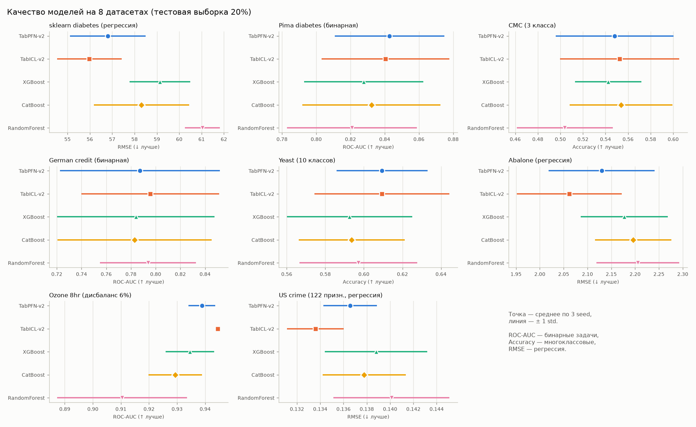
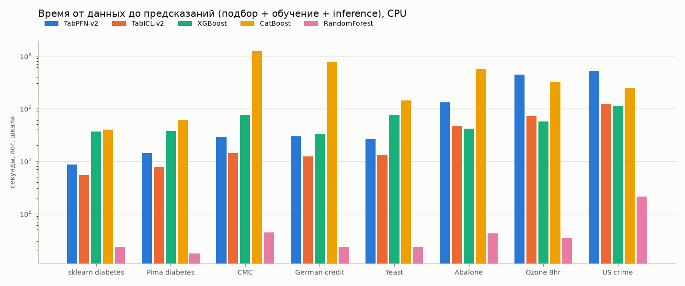
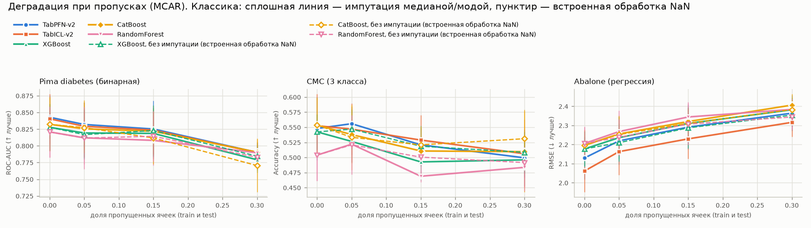
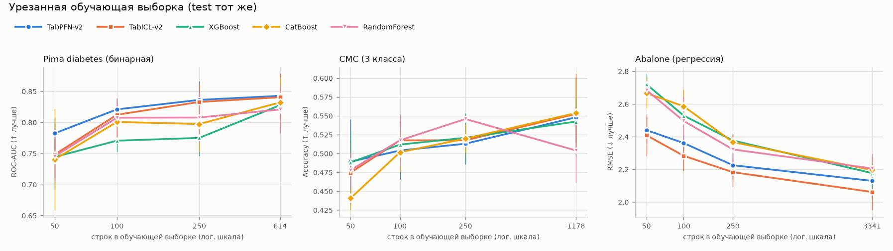
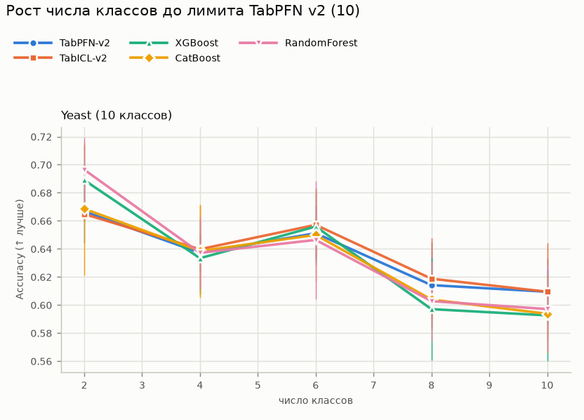
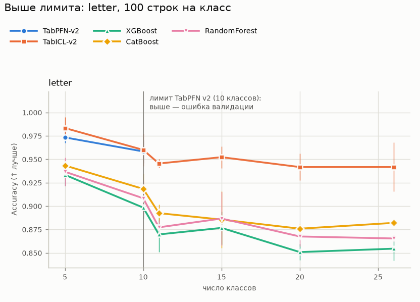

# TabPFN v2 и TabICL v2 против XGBoost, CatBoost и RandomForest: воспроизводимый бенчмарк

**Built with PriorLabs-TabPFN.** Отчёт о бенчмарке от 23.09.2026. Сравнивались две табличные
foundation-модели — TabPFN v2 и TabICL v2 — без какой-либо настройки против XGBoost и CatBoost
с подбором гиперпараметров и RandomForest с параметрами по умолчанию. Условия: 8 открытых
датасетов, 3 seed, 120 прогонов в основном бенчмарке и 501 в стресс-тестах. Всё посчитано
**только на CPU** (ноутбук без GPU).

## Коротко

| | Результат |
|---|---|
| **Качество** | Foundation-модели без настройки не хуже настроенных бустингов, чаще немного лучше. Лучшая модель по основной метрике: TabICL v2 — на 5 датасетах из 8, TabPFN v2 — на 1, ещё на одном они делят первое место. Средний ранг (1 — лучший): **TabICL v2 1.31**, TabPFN v2 2.06, CatBoost 3.38, XGBoost 3.88, RandomForest 4.38. |
| **Насколько** | Отрыв небольшой. На одинаковых разбиениях TabICL v2 лучше XGBoost в **22 из 24** пар «датасет × seed», в среднем на **+2.6** п.п. (для регрессии — % снижения RMSE); лучше CatBoost в **21 из 24**, в среднем на **+2.3**. У TabPFN v2 — 21/24 и 18/24, +1.5 и +1.2. Для отдельного датасета разница сопоставима с разбросом между seed (std 1–5 п.п.). |
| **Где проигрывают** | Явных проигрышей в основном бенчмарке нет. В пределах шума уступают CatBoost: на cmc (accuracy −0.1…−0.6 п.п.) и на pima по accuracy/F1 (−0.9…−1.3 п.п., хотя по ROC-AUC впереди). В стресс-тестах преимущество пропадает при 30% пропусков (pima, cmc) и на cmc при урезанной выборке. TabPFN v2 не работает при числе классов > 10. |
| **Время (CPU)** | На все 8 датасетов, один seed: TabICL v2 — **291 с**, XGBoost с подбором — 470 с, TabPFN v2 — 1206 с, CatBoost с подбором — 3383 с, RandomForest — 4 с. На датасетах до ~1200 строк TabICL v2 укладывается в 5–14 с, TabPFN v2 — в 9–30 с, а подбор занимает 33–76 с у XGBoost и 40–1238 с у CatBoost. На широких данных (72–122 признака) TabPFN v2 на CPU медленнее подбора XGBoost в 4.6–7.8 раза. |
| **Стресс-тесты** | Малые выборки (50–250 строк) — главное преимущество foundation-моделей: на abalone при 50 строках ошибка на 8.5–9.7% ниже лучшей классики. Пропуски (MCAR): деградация у всех сопоставима, встроенная обработка NaN у foundation-моделей преимущества не дала. Число классов: TabPFN v2 при > 10 классах падает с ошибкой, TabICL v2 работает до 26 классов и остаётся впереди. |

**Практический вывод.** Для небольших таблиц (до нескольких тысяч строк) TabICL v2 — сильная модель
по умолчанию: без настройки она лучше или наравне с настроенными бустингами и на CPU работает
быстрее подбора гиперпараметров. TabPFN v2 по качеству близок, но на CPU заметно медленнее, и
у него жёсткий лимит в 10 классов. Выводы получены на небольших датасетах. Переносить их на
большие данные (десятки тысяч строк и больше, где традиционно сильны бустинги) нельзя без
отдельной проверки (см. раздел 6).

---

## 1. Методология

### 1.1. Что сравнивалось

| Модель | Тип | Как запускалась |
|---|---|---|
| **XGBoost** 3.4.1 | градиентный бустинг | `RandomizedSearchCV`, 20 итераций × 3 фолда, затем обучение лучшей конфигурации на всём train |
| **CatBoost** 1.2.10 | градиентный бустинг | то же самое |
| **RandomForest** (scikit-learn 1.9.1) | бэггинг деревьев | параметры по умолчанию, без подбора (базовая линия «без усилий») |
| **TabPFN v2** (пакет `tabpfn` 9.0.0, веса v2) | табличная foundation-модель | без настройки, параметры по умолчанию для версии v2 |
| **TabICL v2** (пакет `tabicl` 2.2.0, чекпоинт `*-v2-20260212`) | табличная foundation-модель | без настройки, параметры по умолчанию |

**Пространства подбора гиперпараметров:**
- XGBoost: `n_estimators` 100–1000, `learning_rate` 0.01–0.3 (лог.), `max_depth` 2–10,
  `min_child_weight` 1–20 (лог.), `subsample` и `colsample_bytree` 0.5–1.0,
  `reg_lambda` 0.01–10 (лог.), `reg_alpha` 0.001–1 (лог.).
- CatBoost: `iterations` 200–1000, `learning_rate` 0.01–0.3 (лог.), `depth` 4–8,
  `l2_leaf_reg` 1–10 (лог.), `bagging_temperature` 0–1, `random_strength` 0.1–10 (лог.).

Критерий подбора: log-loss для классификации, RMSE для регрессии.

**Версии foundation-моделей.** Пакет `tabpfn` 9.0.0 по умолчанию загружает TabPFN-3.5,
у которого некоммерческая лицензия. Поэтому модель везде создаётся явно через
`create_default_for_version(ModelVersion.V2)`, с чекпоинтами
`tabpfn-v2-classifier-finetuned-zk73skhh.ckpt` и `tabpfn-v2-regressor.ckpt`.
TabPFN-2.5/2.6/3/3.5 и TabFM (Google) не использовались (см. раздел 7).

### 1.2. Протокол

1. Разбиение train/test 80/20: стратифицированное для классификации, случайное для
   регрессии. Временной компоненты в данных нет, поэтому time-based split не нужен.
2. Каждый прогон повторён с тремя seed (0, 1, 2). Seed меняет разбиение train/test, фолды
   подбора и инициализацию моделей. В таблицах — среднее ± стандартное отклонение по seed.
3. Метрики на тестовой выборке:
   - классификация: accuracy, F1, ROC-AUC, PR-AUC (для бинарных), log-loss;
   - регрессия: RMSE, MAE, R².

   F1 в бинарной задаче считается для миноритарного класса, в многоклассовой — macro-F1.
   Класс предсказывается как argmax вероятности, без подбора порога.
4. Время «от данных до предсказаний»:
   - XGBoost, CatBoost: подбор + финальное обучение + предсказание;
   - foundation-модели: загрузка весов с диска + `fit` (предобработка, подготовка
     контекста) + предсказание.

   Скачивание весов из интернета (одноразовое) в замер не входит. Прогоны шли строго
   последовательно, без параллельной нагрузки на машину.
5. Каждый прогон сохраняется отдельным JSON (`results/raw/`), любой шаг можно перезапустить.

### 1.3. Датасеты

| Датасет | Источник | Задача | Строк (train) | Признаков (из них кат.) | Классы / баланс | Пропуски | Категории ТЗ |
|---|---|---|---|---|---|---|---|
| pima_diabetes | [OpenML 37](https://www.openml.org/d/37) | бинарная | 768 (614) | 8 (0) | 2 кл.; миноритарный — 34.9% | нет | маленький, бинарная |
| credit_g | [OpenML 31](https://www.openml.org/d/31) | бинарная | 1000 (800) | 20 (13) | 2 кл.; миноритарный — 30.0% | нет | средний, бинарная, много категориальных |
| ozone_level_8hr | [OpenML 1487](https://www.openml.org/d/1487) | бинарная | 2534 (2027) | 72 (0) | 2 кл.; миноритарный — 6.3% | нет | средний, бинарная, дисбаланс |
| cmc | [OpenML 23](https://www.openml.org/d/23) | многоклассовая | 1473 (1178) | 9 (7) | 3 кл.; миноритарный — 22.6% | нет | средний, многоклассовая, много категориальных |
| sklearn_diabetes | `sklearn.datasets.load_diabetes` | регрессия | 442 (353) | 10 (0) | — | нет | маленький, регрессия |
| abalone | [OpenML 42726](https://www.openml.org/d/42726) | регрессия | 4177 (3341) | 8 (1) | — | нет | средний, регрессия, категориальные |
| yeast | [OpenML 181](https://www.openml.org/d/181) | многоклассовая | 1484 (1187) | 8 (0) | 10 кл.; миноритарный — 0.3% | нет | средний, многоклассовая, дисбаланс |
| us_crime | [OpenML 315](https://www.openml.org/d/315) | регрессия | 1994 (1595) | 122 (0) | — | 36851 ячеек | средний, 100+ признаков, регрессия, реальные пропуски |
| letter *(только стресс-тест)* | [OpenML 6](https://www.openml.org/d/6) | многоклассовая | 20000 (по 100 строк на класс) | 16 (0) | 26 кл.; миноритарный — 3.7% | нет | зонд числа классов |

Разбиение train/test 80/20 (для классификации — стратифицированное). Описания и ссылки — в `datasets_manifest.json`. В us_crime удалены 5 служебных колонок (штат, округ, название общины, номер фолда). Лимиты моделей сверены с исходным кодом: TabPFN v2 — до 10 000 строк, 500 признаков, 10 классов; TabICL v2 — рекомендовано 300–48 000 строк и до 100 признаков, больше 10 классов — через иерархическую схему.

### 1.4. Окружение

- **Только CPU, GPU нет** (`torch.cuda.is_available() == False`). Intel Core i3-1115G4
  (2 ядра / 4 потока), 7.8 ГБ RAM, Windows 11, Python 3.14.2.
- Все модели используют 4 потока: `n_jobs=-1` у классики, `torch.set_num_threads(4)` у
  foundation-моделей.
- Точные версии всех пакетов — в `requirements.txt` (`pip freeze`). Окружение и пути к
  весам — в `results/environment.json`.
- Foundation-модели рассчитаны на GPU. На CPU они в разы медленнее, поэтому абсолютные
  времена в этом отчёте применимы только к слабому CPU. Соотношение времён на GPU будет
  другим (см. раздел 6).

---

## 2. Сводная таблица

Основная метрика: ROC-AUC для бинарной классификации, accuracy для многоклассовой, RMSE для регрессии (меньше — лучше). **Жирным** — лучший результат в строке.

| Датасет | Метрика | XGBoost | CatBoost | RandomForest | TabPFN-v2 | TabICL-v2 |
|---|---|---|---|---|---|---|
| sklearn_diabetes | RMSE | 59.137 ± 1.351 | 58.312 ± 2.135 | 61.034 ± 0.782 | 56.806 ± 1.694 | **55.981 ± 1.439** |
| pima_diabetes | ROC-AUC | 0.828 ± 0.035 | 0.832 ± 0.040 | 0.821 ± 0.038 | **0.843 ± 0.032** | 0.840 ± 0.037 |
| cmc | Accuracy | 0.542 ± 0.030 | **0.554 ± 0.046** | 0.504 ± 0.043 | 0.548 ± 0.052 | 0.553 ± 0.053 |
| credit_g | ROC-AUC | 0.784 ± 0.064 | 0.783 ± 0.062 | 0.794 ± 0.039 | 0.787 ± 0.065 | **0.796 ± 0.056** |
| yeast | Accuracy | 0.593 ± 0.032 | 0.594 ± 0.027 | 0.597 ± 0.031 | **0.609 ± 0.024** | **0.609 ± 0.035** |
| abalone | RMSE | 2.177 ± 0.092 | 2.196 ± 0.080 | 2.206 ± 0.087 | 2.130 ± 0.112 | **2.062 ± 0.110** |
| ozone_level_8hr | ROC-AUC | 0.935 ± 0.009 | 0.929 ± 0.010 | 0.910 ± 0.023 | 0.939 ± 0.005 | **0.944 ± 0.001** |
| us_crime | RMSE | 0.139 ± 0.004 | 0.138 ± 0.004 | 0.140 ± 0.005 | 0.137 ± 0.002 | **0.134 ± 0.002** |



Полные таблицы по всем метрикам (accuracy, F1, ROC-AUC, PR-AUC, log-loss, RMSE, MAE, R²) —
в приложении A. Сырые результаты: `benchmark_results.csv` (среднее ± std) и
`benchmark_results_per_seed.csv` (каждый прогон, включая найденные гиперпараметры).

---

## 3. Выводы: где foundation-модели выигрывают и где проигрывают

### 3.1. Общая картина

**Средний ранг по основной метрике** (1 — лучший; усреднение по 8 датасетам):

| Модель | Средний ранг |
|---|---|
| TabICL-v2 | 1.31 |
| TabPFN-v2 | 2.06 |
| CatBoost | 3.38 |
| XGBoost | 3.88 |
| RandomForest | 4.38 |

**Попарное сравнение на одинаковых разбиениях** (8 датасетов × 3 seed = 24 пары). Модели сравниваются на одном и том же train/test (тот же seed), по основной метрике. «Побед» — в скольких парах foundation-модель лучше; «средняя разница» — среднее по парам (п.п. для ROC-AUC/accuracy; % снижения RMSE для регрессии; + = foundation лучше).

| Foundation | vs | Побед | Средняя разница | Мин. / макс. разница |
|---|---|---|---|---|
| TabPFN-v2 | XGBoost | 21 из 24 | +1.53 | -2.03 / +5.50 |
| TabPFN-v2 | CatBoost | 18 из 24 | +1.23 | -1.77 / +5.65 |
| TabPFN-v2 | RandomForest | 21 из 24 | +2.86 | -3.54 / +8.25 |
| TabICL-v2 | XGBoost | 22 из 24 | +2.56 | -1.69 / +7.64 |
| TabICL-v2 | CatBoost | 21 из 24 | +2.27 | -1.02 / +8.71 |
| TabICL-v2 | RandomForest | 23 из 24 | +3.88 | -1.77 / +10.32 |

Обе foundation-модели без настройки в среднем лучше всех классических моделей, включая
настроенные бустинги. TabICL v2 стабильнее TabPFN v2: лучше XGBoost и CatBoost в 21–22 парах
из 24, а худший её проигрыш — всего 1.0–1.7 п.п. Средний отрыв небольшой, 1–4 п.п.

Для отдельного датасета эта разница сопоставима со стандартным отклонением между seed.
Поэтому утверждение «foundation-модель лучше на датасете X» по одному датасету статистически
слабое. Устойчиво другое: это направление повторяется почти на всех датасетах и разбиениях.

### 3.2. Разница с лучшей классической моделью по каждому датасету

Для accuracy/F1/ROC-AUC — разница в процентных пунктах (п.п.); для RMSE/MAE — относительное снижение ошибки в %; для R² — абсолютная разница. Положительное значение = foundation-модель лучше. «Лучшая классика» выбирается по каждой метрике отдельно (среди XGBoost/CatBoost/RandomForest).

| Датасет | Метрика | Лучшая классика | TabPFN-v2 vs она | TabICL-v2 vs она |
|---|---|---|---|---|
| sklearn_diabetes | rmse | CatBoost (58.312) | +2.58 % ошибки | +4.00 % ошибки |
| sklearn_diabetes | mae | CatBoost (45.575) | +3.30 % ошибки | +2.93 % ошибки |
| sklearn_diabetes | r2 | CatBoost (0.360) | +0.032 | +0.050 |
| pima_diabetes | accuracy | CatBoost (0.775) | -0.87 п.п. | -1.08 п.п. |
| pima_diabetes | f1 | CatBoost (0.632) | -1.05 п.п. | -1.32 п.п. |
| pima_diabetes | roc_auc | CatBoost (0.832) | +1.06 п.п. | +0.83 п.п. |
| cmc | accuracy | CatBoost (0.554) | -0.56 п.п. | -0.11 п.п. |
| cmc | f1 | CatBoost (0.526) | -0.31 п.п. | +0.16 п.п. |
| cmc | roc_auc | CatBoost (0.746) | +0.36 п.п. | +0.66 п.п. |
| credit_g | accuracy | RandomForest (0.762) | +1.17 п.п. | +0.33 п.п. |
| credit_g | f1 | RandomForest (0.522) | +2.55 п.п. | +2.48 п.п. |
| credit_g | roc_auc | RandomForest (0.794) | -0.67 п.п. | +0.17 п.п. |
| yeast | accuracy | RandomForest (0.597) | +1.23 п.п. | +1.23 п.п. |
| yeast | f1 | CatBoost (0.484) | +5.93 п.п. | +2.49 п.п. |
| yeast | roc_auc | CatBoost (0.893) | +0.76 п.п. | +1.26 п.п. |
| abalone | rmse | XGBoost (2.177) | +2.18 % ошибки | +5.30 % ошибки |
| abalone | mae | XGBoost (1.513) | +3.77 % ошибки | +5.12 % ошибки |
| abalone | r2 | XGBoost (0.567) | +0.019 | +0.045 |
| ozone_level_8hr | accuracy | XGBoost (0.946) | +0.39 п.п. | +0.07 п.п. |
| ozone_level_8hr | f1 | XGBoost (0.377) | +7.00 п.п. | +3.96 п.п. |
| ozone_level_8hr | roc_auc | XGBoost (0.935) | +0.43 п.п. | +0.99 п.п. |
| us_crime | rmse | CatBoost (0.138) | +0.88 % ошибки | +3.04 % ошибки |
| us_crime | mae | CatBoost (0.091) | +2.68 % ошибки | +3.56 % ошибки |
| us_crime | r2 | CatBoost (0.650) | +0.006 | +0.021 |

### 3.3. Где foundation-модели выигрывают

- **Регрессия — везде и заметнее всего.** Ошибка TabICL v2 ниже, чем у лучшей классики:
  RMSE на 4.0% (sklearn_diabetes), 5.3% (abalone) и 3.0% (us_crime); R² выше на 0.02–0.05.
  TabPFN v2 тоже лучше классики на всех трёх датасетах, на 0.9–2.6% по RMSE.
- **Миноритарные классы при пороге по умолчанию.** На ozone (6% позитивов) F1 миноритарного
  класса у TabPFN v2 на 7.0 п.п. выше, чем у лучшей классики, у TabICL v2 — на 4.0 п.п. На
  yeast macro-F1 выше на 5.9 п.п. (TabPFN) и 2.5 п.п. (TabICL). Log-loss у foundation-моделей
  тоже ниже почти везде: вероятности у них точнее. Правдоподобное (но не проверенное
  отдельно) объяснение — поэтому argmax чаще попадает в редкие классы. При отдельном подборе
  порога этот эффект может уменьшиться; здесь порог не подбирался ни для одной модели.
- **Ранжирование на дисбалансе.** На ozone ROC-AUC TabICL v2 — 0.944 ± 0.001 против 0.935 у
  XGBoost; PR-AUC — 0.588 против 0.543. Разброс между seed у TabICL самый низкий из всех
  моделей.
- **Маленькие выборки** — см. раздел 5.2: там разница самая большая.

### 3.4. Где проигрывают или не выигрывают

- **cmc (3 класса, 7 категориальных признаков):** по accuracy CatBoost лучше на 0.1 п.п.
  (TabICL) и 0.6 п.п. (TabPFN), по ROC-AUC — наоборот. Фактически ничья.
- **pima_diabetes по accuracy и F1:** CatBoost лучше на 0.9–1.3 п.п., хотя по ROC-AUC обе
  foundation-модели впереди (+0.8…+1.1 п.п.). Разница в пределах разброса (std 2–5 п.п.).
- **credit_g, ROC-AUC:** TabPFN v2 на 0.7 п.п. хуже RandomForest по умолчанию, TabICL — на
  уровне RF.
- **RandomForest по умолчанию — неожиданно сильная базовая линия** на credit_g и yeast: там
  он лучше настроенных XGBoost и CatBoost. Настройка бустингов на малых данных не всегда
  окупается.
- В стресс-тестах (раздел 5) преимущество пропадает при сильных пропусках и на cmc при
  урезанной выборке. TabPFN v2 не работает при > 10 классах.

---

## 4. Время разработки и настройки

### 4.1. Машинное время

Время «от данных до предсказаний», секунды, среднее по 3 seed. Классика (XGBoost, CatBoost): RandomizedSearchCV (20 итераций × 3 фолда) + финальное обучение + предсказание. RandomForest: обучение с параметрами по умолчанию + предсказание. Foundation-модели: загрузка весов + fit + предсказание, без настройки. CPU, без GPU.

| Датасет | n_train × признаков | XGBoost | CatBoost | RandomForest | TabPFN-v2 | TabICL-v2 |
|---|---|---|---|---|---|---|
| sklearn_diabetes | 353 × 10 | 36.6 | 40.2 | 0.2 | 8.7 | 5.4 |
| pima_diabetes | 614 × 8 | 37.5 | 60.3 | 0.2 | 14.2 | 7.8 |
| cmc | 1178 × 9 | 75.5 | 1238 | 0.4 | 28.3 | 14.2 |
| credit_g | 800 × 20 | 32.7 | 775 | 0.2 | 29.9 | 12.2 |
| yeast | 1187 × 8 | 75.5 | 141 | 0.2 | 25.9 | 13.0 |
| abalone | 3341 × 8 | 41.7 | 565 | 0.4 | 131 | 45.7 |
| ozone_level_8hr | 2027 × 72 | 56.7 | 317 | 0.3 | 444 | 71.3 |
| us_crime | 1595 × 122 | 114 | 247 | 2.1 | 523 | 121 |
| **Сумма по 8 датасетам** | | 470 | 3383 | 4.2 | 1206 | 291 |



- **TabICL v2 — самый быстрый путь к хорошему результату на CPU:** 291 с на все 8
  датасетов, от 5 до 121 с на датасет. Это быстрее подбора XGBoost (470 с) и в 12 раз быстрее
  подбора CatBoost (3383 с).
- **TabPFN v2 на CPU плохо масштабируется.** На маленьких данных у него 9–30 с. На ozone
  (2027 × 72) и us_crime (1595 × 122) — 444 и 523 с, дольше подбора XGBoost. Время растёт
  быстрее, чем линейно, с числом строк и признаков. На GPU картина другая: модель рассчитана
  на GPU, здесь это не измерялось.
- **Подбор CatBoost — самая дорогая операция бенчмарка.** С категориальными признаками это
  565–1238 с. Время почти не зависит от объёма данных: на 50 строках cmc — 655 с (раздел
  5.2). На cmc время дополнительно завышено: один seed считался, пока ноутбук работал от
  батареи (2108 с против 665 и 940 с у других seed).
- **RandomForest по умолчанию** — секунды, но по качеству в среднем последний (ранг 4.38).

### 4.2. Время разработчика

Для практики это не менее важная метрика: сколько решений и кода нужно до первого
приличного результата.

| | XGBoost / CatBoost (с подбором) | TabPFN v2 / TabICL v2 |
|---|---|---|
| Что нужно решить | пространство поиска (8 и 6 гиперпараметров), схему CV, критерий подбора, число итераций | ничего: `fit` / `predict` с параметрами по умолчанию |
| Категориальные признаки | XGBoost: `category` dtype + `enable_categorical`; CatBoost: `cat_features` — только через `fit()`, иначе ломается `sklearn.clone` внутри `RandomizedSearchCV` | TabPFN: индексы категориальных колонок; TabICL: сам распознаёт по dtype |
| Пропуски | встроенная обработка (или импутация) | встроенная обработка |
| Подводные камни, встреченные здесь | подбор CatBoost с категориальными признаками дорог даже на крошечных данных | **TabPFN:** пакет `tabpfn` по умолчанию грузит TabPFN-3.5 с некоммерческой лицензией — нужно явно выбрать v2; на CPU пакет отказывается работать с > 1000 строк без `TABPFN_ALLOW_CPU_LARGE_DATASET=true`; жёсткие лимиты 10 классов / 500 признаков / 10 000 строк. **TabICL:** на 2000 × 216 не хватило памяти на машине с 8 ГБ RAM (датасет пришлось заменить) |
| Железо | CPU достаточно | рассчитаны на GPU; на CPU приемлемо до ~1–2 тыс. строк × десятки признаков |

**Итог по времени.** Foundation-модели почти полностью убирают работу по настройке: не нужно
проектировать подбор, и нет риска сделать его плохо. Цена — тяжёлый inference и лицензионная
внимательность. Для TabPFN это ещё и лимиты по размеру данных.

---

## 5. Стресс-тест ограничений

Датасеты: pima_diabetes (бинарная), cmc (3 класса, категориальные признаки), abalone (регрессия);
для числа классов — yeast и дополнительно letter. Все эксперименты — 3 seed на тех же
разбиениях, что и в разделе 2. Сырые результаты: `results/stress_results.csv`.

### 5.1. Пропуски в данных (5%, 15%, 30% ячеек, MCAR)

**Как пропуски обрабатываются внутри foundation-моделей** (проверено по исходному коду
установленных версий):
- **TabPFN v2** — встроенная обработка в самой модели. До заполнения строится индикатор
  пропуска для каждого значения (NaN → −2.0), пропуск заменяется средним по train, и
  модель получает и значение, и индикатор (`tabpfn/architectures/tabpfn_v2.py`). То есть
  модель «видит» факт пропуска.
- **TabICL v2** — простая импутация в предобработке: числовые пропуски заполняются средним
  (`SimpleImputer`), категориальные кодируются отдельным значением
  (`tabicl/_sklearn/preprocessing.py`). Индикатора пропуска для числовых признаков нет.

**Протокол.** Пропуски вносятся случайно (MCAR) и в train, и в test. Классика — «обычная»
импутация (медиана/мода по train, как в ТЗ) с гиперпараметрами из раздела 2. Для полноты те же
модели запущены и без импутации, со встроенной обработкой NaN (пунктир на графике).
Foundation-модели получают NaN как есть.

**abalone** — RMSE (среднее ± std по seed)

| Модель | 0% | 5% | 15% | 30% |
|---|---|---|---|---|
| TabPFN-v2 | 2.130 ± 0.112 | 2.219 ± 0.124 | 2.291 ± 0.116 | 2.364 ± 0.093 |
| TabICL-v2 | 2.062 ± 0.110 | 2.163 ± 0.121 | 2.230 ± 0.104 | 2.316 ± 0.074 |
| XGBoost | 2.177 ± 0.092 | 2.236 ± 0.111 | 2.310 ± 0.081 | 2.382 ± 0.064 |
| CatBoost | 2.196 ± 0.080 | 2.256 ± 0.096 | 2.320 ± 0.078 | 2.406 ± 0.059 |
| RandomForest | 2.206 ± 0.087 | 2.268 ± 0.110 | 2.344 ± 0.078 | 2.384 ± 0.054 |
| XGBoost (native NaN) | 2.177 ± 0.092 | 2.210 ± 0.098 | 2.287 ± 0.106 | 2.354 ± 0.059 |
| CatBoost (native NaN) | 2.196 ± 0.080 | 2.253 ± 0.098 | 2.311 ± 0.076 | 2.383 ± 0.052 |
| RandomForest (native NaN) | 2.206 ± 0.087 | 2.238 ± 0.095 | 2.307 ± 0.108 | 2.344 ± 0.066 |

**cmc** — Accuracy (среднее ± std по seed)

| Модель | 0% | 5% | 15% | 30% |
|---|---|---|---|---|
| TabPFN-v2 | 0.548 ± 0.052 | 0.556 ± 0.028 | 0.521 ± 0.028 | 0.499 ± 0.047 |
| TabICL-v2 | 0.553 ± 0.053 | 0.547 ± 0.043 | 0.529 ± 0.042 | 0.506 ± 0.056 |
| XGBoost | 0.542 ± 0.030 | 0.527 ± 0.035 | 0.493 ± 0.031 | 0.496 ± 0.029 |
| CatBoost | 0.554 ± 0.046 | 0.538 ± 0.047 | 0.511 ± 0.019 | 0.510 ± 0.067 |
| RandomForest | 0.504 ± 0.043 | 0.522 ± 0.030 | 0.469 ± 0.010 | 0.484 ± 0.039 |
| XGBoost (native NaN) | 0.542 ± 0.030 | 0.547 ± 0.033 | 0.519 ± 0.033 | 0.508 ± 0.034 |
| CatBoost (native NaN) | 0.554 ± 0.046 | 0.533 ± 0.054 | 0.521 ± 0.031 | 0.531 ± 0.048 |
| RandomForest (native NaN) | 0.504 ± 0.043 | 0.521 ± 0.049 | 0.501 ± 0.029 | 0.492 ± 0.026 |

**pima_diabetes** — ROC-AUC (среднее ± std по seed)

| Модель | 0% | 5% | 15% | 30% |
|---|---|---|---|---|
| TabPFN-v2 | 0.843 ± 0.032 | 0.832 ± 0.033 | 0.825 ± 0.042 | 0.790 ± 0.010 |
| TabICL-v2 | 0.840 ± 0.037 | 0.829 ± 0.035 | 0.824 ± 0.037 | 0.790 ± 0.016 |
| XGBoost | 0.828 ± 0.035 | 0.819 ± 0.038 | 0.819 ± 0.038 | 0.779 ± 0.019 |
| CatBoost | 0.832 ± 0.040 | 0.825 ± 0.042 | 0.822 ± 0.034 | 0.791 ± 0.021 |
| RandomForest | 0.821 ± 0.038 | 0.812 ± 0.040 | 0.808 ± 0.037 | 0.790 ± 0.014 |
| XGBoost (native NaN) | 0.828 ± 0.035 | 0.817 ± 0.037 | 0.823 ± 0.038 | 0.785 ± 0.020 |
| CatBoost (native NaN) | 0.832 ± 0.040 | 0.827 ± 0.038 | 0.812 ± 0.039 | 0.770 ± 0.040 |
| RandomForest (native NaN) | 0.821 ± 0.038 | 0.812 ± 0.047 | 0.814 ± 0.038 | 0.783 ± 0.010 |



**Выводы:**
- **Деградация у всех сопоставима, у foundation-моделей — чуть сильнее.** При переходе от 0% к
  30% пропусков ROC-AUC на pima падает на 5.0–5.3 п.п. у foundation-моделей и на 3.1–4.9 п.п.
  у классики с импутацией. Accuracy на cmc — на 4.6–4.9 п.п. против 2.0–4.6. Ошибка на abalone
  растёт на 11–12% против 8–10%.
- **Итог по уровням.** На pima и cmc преимущество foundation-моделей при 30% пропусков
  исчезает: на pima все модели около 0.79 ROC-AUC, на cmc лучший — CatBoost со встроенной
  обработкой NaN (0.531 против 0.506 у TabICL). На abalone TabICL v2 остаётся лучшей и при
  30% (RMSE 2.316 против 2.344 у лучшей классики).
- **Индикаторы пропусков TabPFN v2 при MCAR не помогли**: TabPFN и TabICL деградируют
  одинаково. Это ожидаемо: при MCAR сам факт пропуска не несёт информации о целевой
  переменной. При неслучайных пропусках (MNAR) результат может быть другим, это не проверялось.
- **Встроенная обработка NaN у бустингов и RF лучше импутации медианой** в 7 из 9 сравнений
  при 30% пропусков.

### 5.2. Урезанная обучающая выборка (50, 100, 250 строк)

Train — стратифицированная подвыборка из train того же seed, test тот же, что в разделе 2.
Классика заново подбирает гиперпараметры на урезанной выборке (20 итераций × 3 фолда).

**abalone** — RMSE (среднее ± std по seed)

| Модель | 50 | 100 | 250 | 3341 |
|---|---|---|---|---|
| TabPFN-v2 | 2.440 ± 0.078 | 2.361 ± 0.045 | 2.225 ± 0.085 | 2.130 ± 0.112 |
| TabICL-v2 | 2.409 ± 0.128 | 2.283 ± 0.091 | 2.183 ± 0.087 | 2.062 ± 0.110 |
| XGBoost | 2.720 ± 0.063 | 2.529 ± 0.055 | 2.376 ± 0.036 | 2.177 ± 0.092 |
| CatBoost | 2.667 ± 0.092 | 2.586 ± 0.101 | 2.367 ± 0.047 | 2.196 ± 0.080 |
| RandomForest | 2.685 ± 0.025 | 2.496 ± 0.150 | 2.322 ± 0.095 | 2.206 ± 0.087 |

**cmc** — Accuracy (среднее ± std по seed)

| Модель | 50 | 100 | 250 | 1178 |
|---|---|---|---|---|
| TabPFN-v2 | 0.489 ± 0.056 | 0.504 ± 0.038 | 0.513 ± 0.027 | 0.548 ± 0.052 |
| TabICL-v2 | 0.475 ± 0.042 | 0.518 ± 0.025 | 0.518 ± 0.025 | 0.553 ± 0.053 |
| XGBoost | 0.488 ± 0.042 | 0.512 ± 0.024 | 0.521 ± 0.032 | 0.542 ± 0.030 |
| CatBoost | 0.441 ± 0.016 | 0.502 ± 0.026 | 0.520 ± 0.019 | 0.554 ± 0.046 |
| RandomForest | 0.478 ± 0.024 | 0.518 ± 0.034 | 0.546 ± 0.003 | 0.504 ± 0.043 |

**pima_diabetes** — ROC-AUC (среднее ± std по seed)

| Модель | 50 | 100 | 250 | 614 |
|---|---|---|---|---|
| TabPFN-v2 | 0.782 ± 0.026 | 0.821 ± 0.017 | 0.836 ± 0.030 | 0.843 ± 0.032 |
| TabICL-v2 | 0.748 ± 0.037 | 0.812 ± 0.022 | 0.833 ± 0.030 | 0.840 ± 0.037 |
| XGBoost | 0.744 ± 0.053 | 0.771 ± 0.019 | 0.775 ± 0.029 | 0.828 ± 0.035 |
| CatBoost | 0.740 ± 0.081 | 0.801 ± 0.025 | 0.797 ± 0.045 | 0.832 ± 0.040 |
| RandomForest | 0.745 ± 0.040 | 0.808 ± 0.032 | 0.808 ± 0.040 | 0.821 ± 0.038 |



**Выводы:**
- **abalone (регрессия): чем меньше данных, тем больше отрыв.** При 50 строках RMSE TabICL v2 —
  2.409, TabPFN v2 — 2.440, лучшей классики (CatBoost) — 2.667: ошибка на 9.7% и 8.5% ниже.
  На полном train отрыв 5.3%. От полного train до 50 строк ошибка foundation-моделей растёт на
  15–17%, классики — на 21–25%.
- **pima (бинарная): TabPFN v2 падает меньше всех.** ROC-AUC при 50 строках — 0.782 против
  0.745 у лучшей классики (+3.7 п.п.), потеря от полного train — 6.0 п.п. против 7.6–9.2 у
  классики. TabICL v2 при 50 строках падает как классика (0.748). Это ожидаемо: рекомендованный
  минимум для TabICL — 300 строк. При 100–250 строках TabICL снова впереди (+0.4…+2.5 п.п.).
- **cmc (3 класса, категориальные признаки): преимущества нет.** При 50 строках все модели
  около 0.47–0.49 accuracy, кроме CatBoost (0.441). При 250 строках лучший — RandomForest (0.546
  против 0.513–0.518).
- **Время на малых данных:** foundation-моделям нужно 2–16 с, подбор XGBoost занимает 24–37 с,
  подбор CatBoost — 33–663 с.

### 5.3. Число классов: до лимита и выше

**До лимита — yeast** (k самых частых классов из 10; k = 10 — основной бенчмарк; классика —
с гиперпараметрами из раздела 2):

**yeast** — Accuracy (среднее ± std по seed)

| Модель | 2 | 4 | 6 | 8 | 10 |
|---|---|---|---|---|---|
| TabPFN-v2 | 0.667 ± 0.023 | 0.637 ± 0.014 | 0.651 ± 0.020 | 0.614 ± 0.031 | 0.609 ± 0.024 |
| TabICL-v2 | 0.665 ± 0.006 | 0.640 ± 0.031 | 0.657 ± 0.023 | 0.619 ± 0.029 | 0.609 ± 0.035 |
| XGBoost | 0.689 ± 0.025 | 0.633 ± 0.026 | 0.656 ± 0.027 | 0.597 ± 0.037 | 0.593 ± 0.032 |
| CatBoost | 0.669 ± 0.048 | 0.638 ± 0.033 | 0.650 ± 0.033 | 0.604 ± 0.022 | 0.594 ± 0.027 |
| RandomForest | 0.696 ± 0.023 | 0.637 ± 0.026 | 0.646 ± 0.042 | 0.603 ± 0.028 | 0.597 ± 0.031 |



Accuracy падает с ростом k у всех моделей: задача усложняется, и добавляются редкие классы.
**Специфической деградации foundation-моделей у лимита нет:** TabPFN v2 на 10 классах работает
штатно. Их относительное преимущество растёт с числом классов: при k = 2 они уступают
RandomForest/XGBoost 2–3 п.п., при k = 4–6 — ничья, при k = 8–10 впереди на 1.0–1.5 п.п.

**Выше лимита — letter** (дополнительный датасет, первые k букв, 100 строк на класс; классика —
с параметрами по умолчанию, без подбора):

**letter** — Accuracy (среднее ± std по seed)

| Модель | 5 | 10 | 11 | 15 | 20 | 26 |
|---|---|---|---|---|---|---|
| TabPFN-v2 | 0.973 ± 0.006 | 0.958 ± 0.013 | ошибка | ошибка | ошибка | ошибка |
| TabICL-v2 | 0.983 ± 0.012 | 0.960 ± 0.017 | 0.945 ± 0.005 | 0.952 ± 0.012 | 0.942 ± 0.014 | 0.942 ± 0.026 |
| XGBoost | 0.933 ± 0.012 | 0.898 ± 0.012 | 0.870 ± 0.019 | 0.877 ± 0.018 | 0.851 ± 0.009 | 0.854 ± 0.013 |
| CatBoost | 0.943 ± 0.006 | 0.918 ± 0.016 | 0.892 ± 0.009 | 0.886 ± 0.030 | 0.876 ± 0.005 | 0.882 ± 0.003 |
| RandomForest | 0.937 ± 0.015 | 0.908 ± 0.019 | 0.877 ± 0.008 | 0.887 ± 0.028 | 0.868 ± 0.011 | 0.865 ± 0.004 |



- **TabPFN v2 при 11 и более классах падает сразу:** `TabPFNValidationError: Number of classes
  11 exceeds the maximum number of classes 10 officially supported by TabPFN`. Запасного
  варианта в самом пакете нет (в отдельном пакете `tabpfn-extensions` есть обёртка для
  многих классов, здесь она не проверялась). До лимита модель сильная: 0.973 и 0.958 при 5
  и 10 классах, на 3–4 п.п. выше классики.
- **TabICL v2 выше 10 классов работает без ошибок** (иерархическая схема, включена по
  умолчанию). Accuracy падает с 0.960 (10 классов) до 0.942 (26 классов), то есть на 1.8 п.п.
  Классика по умолчанию теряет на том же участке 3.6–4.4 п.п. При 26 классах TabICL на 6 п.п.
  впереди CatBoost. Цена — время: при 26 классах 52 с против 10 с при 10 классах.

---

## 6. Ограничения этого исследования

1. **Бенчмарк не исчерпывающий.** 8 датасетов выбраны вручную, а не случайно: по категориям
   из ТЗ и с учётом ограничений железа. Другая выборка датасетов может дать другую картину.
2. **Только небольшие данные: 442–4177 строк, до 122 признаков.** Датасеты на 10–50 тыс. строк
   на этой машине считались бы сутками, а TabPFN v2 на CPU по умолчанию вообще ограничен
   1000 строк. На больших данных, где бустинги традиционно сильнее, а foundation-модели
   упираются в лимиты контекста, выводы могут измениться.
3. **Статистика слабая.** 3 seed, тестовые выборки от 89 до 836 строк. Разница между моделями
   на отдельном датасете часто меньше стандартного отклонения между seed. Формальные
   статистические тесты не проводились; в пользу foundation-моделей говорит повторяемость
   направления эффекта (попарные победы), а не величина отдельных разниц.
4. **Известные публичные датасеты.** Все датасеты давно лежат на OpenML. Foundation-модели
   предобучены на синтетических данных, но их архитектура и настройки по умолчанию
   разрабатывались с оглядкой на такие бенчмарки. Возможен оптимистичный сдвиг в их пользу.
5. **Только CPU и слабый ноутбук.** Абсолютные времена не переносятся на GPU: там
   foundation-модели в разы быстрее. На одном seed cmc время CatBoost завышено из-за работы
   от батареи.
6. **Бюджет подбора классики умеренный:** 20 конфигураций × 3 фолда (минимум по ТЗ).
   Больший бюджет (100+ итераций Optuna, early stopping) мог бы немного улучшить бустинги. С
   другой стороны, foundation-модели тоже не настраивались и не дообучались.
7. **Порог классификации не подбирался** (argmax вероятности). Это влияет на accuracy и F1,
   особенно на ozone. ROC-AUC и PR-AUC от порога не зависят.
8. **Стресс-тесты:** пропуски только MCAR (без MNAR); классика при пропусках и на yeast —
   с гиперпараметрами, подобранными на чистых данных; на letter — без подбора.
9. **Версии моделей.** Использовались TabPFN v2 и TabICL v2 — последние версии с разрешающими
   лицензиями. Более новые TabPFN (2.5 – 3.5), по заявлению разработчиков, сильнее, но
   исключены из-за некоммерческих лицензий. Выводы касаются именно v2.
10. **us_crime** содержит демографические признаки переписи США. Датасет использован только
    как стандартный бенчмарк регрессии с большим числом признаков.

---

## 7. Лицензии и атрибуция

**Built with PriorLabs-TabPFN.**

| Компонент | Версия | Лицензия | Атрибуция |
|---|---|---|---|
| TabPFN v2 — веса `Prior-Labs/TabPFN-v2-clf`, `Prior-Labs/TabPFN-v2-reg` | чекпоинты `tabpfn-v2-classifier-finetuned-zk73skhh.ckpt`, `tabpfn-v2-regressor.ckpt` | Prior Labs License 1.1 (Apache 2.0 + условие атрибуции) | «Built with PriorLabs-TabPFN». Hollmann N., Müller S., Purucker L. et al. *Accurate predictions on small data with a tabular foundation model.* Nature 637, 319–326 (2025) |
| Пакет `tabpfn` | 9.0.0 | Apache License 2.0 | Prior Labs |
| TabICL v2 — пакет `tabicl` и чекпоинты `jingang/TabICL` (`tabicl-*-v2-20260212.ckpt`) | 2.2.0 | BSD 3-Clause | © 2025 Soda team @ Inria. Qu J., Holzmüller D., Varoquaux G., Le Morvan M. *TabICL: A Tabular Foundation Model for In-Context Learning on Large Data.* ICML 2025; чекпоинт v2 — из работы авторов по TabICLv2 (2026) |
| XGBoost | 3.4.1 | Apache License 2.0 | |
| CatBoost | 1.2.10 | Apache License 2.0 | Yandex |
| scikit-learn | 1.9.1 | BSD 3-Clause | |
| Датасеты | OpenML 37, 31, 23, 181, 42726, 1487, 315, 6; `sklearn.datasets.load_diabetes` | по данным OpenML — Public; sklearn diabetes — BSD-3 (scikit-learn), данные Efron et al., 2004 | ссылки — в `datasets_manifest.json` |

**Намеренно не использовались** (требование ТЗ): TabFM (Google) — некоммерческая лицензия на
веса; TabPFN-3 (и 2.5 / 2.6 / 3.5) — некоммерческие лицензии, для продакшена нужна платная.
Пакет `tabpfn` 9.0.0 по умолчанию загружает именно TabPFN-3.5, поэтому в коде версия v2
задана явно: `create_default_for_version(ModelVersion.V2)` (`src/common.py`).

---

## 8. Как воспроизвести

```powershell
# venv лучше создавать вне OneDrive: torch весит несколько ГБ
py -3.14 -m venv .venv
.venv\Scripts\python -m pip install -r requirements.txt   # точные версии; torch — CPU-сборка
.venv\Scripts\python src\env_check.py        # этап 1: проверка окружения, скачивание весов
.venv\Scripts\python src\select_datasets.py  # этап 2: datasets_manifest.json
.venv\Scripts\python src\run_benchmark.py    # этап 3: benchmark_results.csv (~4 ч на этом CPU)
.venv\Scripts\python src\run_stress.py       # этап 4: results/stress_results*.csv (~4 ч)
.venv\Scripts\python src\make_report.py      # таблицы и графики
```

Каждый прогон сохраняется в `results/raw/**.json`. Скрипты можно прерывать и перезапускать:
готовые прогоны пропускаются. Журнал решений агента — `AGENT_LOG.md`.

| Файл | Что внутри |
|---|---|
| `requirements.txt` | точные версии всех пакетов (`pip freeze`) |
| `datasets_manifest.json` | датасеты: источник, размер, признаки, классы, лицензия, покрытие категорий ТЗ |
| `benchmark_results.csv` / `benchmark_results_per_seed.csv` | основной бенчмарк: среднее ± std / каждый прогон |
| `results/stress_results.csv` / `results/stress_results_per_seed.csv` | стресс-тесты |
| `results/deltas.csv` | разница foundation vs лучшая классика по каждой метрике |
| `results/environment.json` | окружение, пути к чекпоинтам |
| `figures/*.png` | графики |

---

## Приложение A. Все метрики

Среднее ± std по 3 seed; время — секунды от данных до предсказаний.

### A.1. Бинарная классификация

| Датасет | Модель | Accuracy | F1 (миноритарный класс) | ROC-AUC | PR-AUC | LogLoss | Время, с |
|---|---|---|---|---|---|---|---|
| pima_diabetes | XGBoost | 0.762 ± 0.027 | 0.609 ± 0.050 | 0.828 ± 0.035 | 0.722 ± 0.064 | 0.484 ± 0.041 | 37.5 |
| pima_diabetes | CatBoost | 0.775 ± 0.032 | 0.632 ± 0.065 | 0.832 ± 0.040 | 0.701 ± 0.075 | 0.478 ± 0.054 | 60.3 |
| pima_diabetes | RandomForest | 0.758 ± 0.048 | 0.604 ± 0.086 | 0.821 ± 0.038 | 0.695 ± 0.061 | 0.489 ± 0.039 | 0.2 |
| pima_diabetes | TabPFN-v2 | 0.766 ± 0.017 | 0.622 ± 0.039 | 0.843 ± 0.032 | 0.725 ± 0.070 | 0.468 ± 0.048 | 14.2 |
| pima_diabetes | TabICL-v2 | 0.764 ± 0.025 | 0.619 ± 0.053 | 0.840 ± 0.037 | 0.721 ± 0.079 | 0.472 ± 0.052 | 7.8 |
| credit_g | XGBoost | 0.758 ± 0.040 | 0.522 ± 0.075 | 0.784 ± 0.064 | 0.636 ± 0.081 | 0.502 ± 0.050 | 32.7 |
| credit_g | CatBoost | 0.750 ± 0.013 | 0.493 ± 0.039 | 0.783 ± 0.062 | 0.631 ± 0.057 | 0.498 ± 0.051 | 775 |
| credit_g | RandomForest | 0.762 ± 0.033 | 0.522 ± 0.059 | 0.794 ± 0.039 | 0.648 ± 0.050 | 0.490 ± 0.028 | 0.2 |
| credit_g | TabPFN-v2 | 0.773 ± 0.038 | 0.548 ± 0.088 | 0.787 ± 0.065 | 0.652 ± 0.080 | 0.494 ± 0.060 | 29.9 |
| credit_g | TabICL-v2 | 0.765 ± 0.044 | 0.547 ± 0.078 | 0.796 ± 0.056 | 0.657 ± 0.087 | 0.485 ± 0.054 | 12.2 |
| ozone_level_8hr | XGBoost | 0.946 ± 0.006 | 0.377 ± 0.187 | 0.935 ± 0.009 | 0.543 ± 0.035 | 0.137 ± 0.003 | 56.7 |
| ozone_level_8hr | CatBoost | 0.946 ± 0.007 | 0.343 ± 0.125 | 0.929 ± 0.010 | 0.540 ± 0.050 | 0.143 ± 0.006 | 317 |
| ozone_level_8hr | RandomForest | 0.943 ± 0.004 | 0.229 ± 0.074 | 0.910 ± 0.023 | 0.499 ± 0.074 | 0.190 ± 0.043 | 0.3 |
| ozone_level_8hr | TabPFN-v2 | 0.950 ± 0.003 | 0.447 ± 0.065 | 0.939 ± 0.005 | 0.543 ± 0.031 | 0.135 ± 0.004 | 444 |
| ozone_level_8hr | TabICL-v2 | 0.947 ± 0.002 | 0.416 ± 0.104 | 0.944 ± 0.001 | 0.588 ± 0.033 | 0.130 ± 0.004 | 71.3 |

### A.2. Многоклассовая классификация

| Датасет | Модель | Accuracy | F1-macro | ROC-AUC | LogLoss | Время, с |
|---|---|---|---|---|---|---|
| cmc | XGBoost | 0.542 ± 0.030 | 0.510 ± 0.014 | 0.734 ± 0.032 | 0.916 ± 0.039 | 75.5 |
| cmc | CatBoost | 0.554 ± 0.046 | 0.526 ± 0.039 | 0.746 ± 0.038 | 0.896 ± 0.046 | 1238 |
| cmc | RandomForest | 0.504 ± 0.043 | 0.482 ± 0.038 | 0.699 ± 0.014 | 1.240 ± 0.167 | 0.4 |
| cmc | TabPFN-v2 | 0.548 ± 0.052 | 0.523 ± 0.042 | 0.750 ± 0.035 | 0.888 ± 0.054 | 28.3 |
| cmc | TabICL-v2 | 0.553 ± 0.053 | 0.527 ± 0.044 | 0.753 ± 0.036 | 0.886 ± 0.058 | 14.2 |
| yeast | XGBoost | 0.593 ± 0.032 | 0.424 ± 0.018 | 0.867 ± 0.019 | 1.082 ± 0.015 | 75.5 |
| yeast | CatBoost | 0.594 ± 0.027 | 0.484 ± 0.088 | 0.893 ± 0.002 | 1.018 ± 0.033 | 141 |
| yeast | RandomForest | 0.597 ± 0.031 | 0.425 ± 0.025 | 0.887 ± 0.015 | 1.366 ± 0.161 | 0.2 |
| yeast | TabPFN-v2 | 0.609 ± 0.024 | 0.544 ± 0.055 | 0.901 ± 0.009 | 0.998 ± 0.033 | 25.9 |
| yeast | TabICL-v2 | 0.609 ± 0.035 | 0.509 ± 0.073 | 0.906 ± 0.005 | 0.988 ± 0.036 | 13.0 |

### A.3. Регрессия

| Датасет | Модель | RMSE | MAE | R² | Время, с |
|---|---|---|---|---|---|
| sklearn_diabetes | XGBoost | 59.137 ± 1.351 | 45.683 ± 1.467 | 0.342 ± 0.052 | 36.6 |
| sklearn_diabetes | CatBoost | 58.312 ± 2.135 | 45.575 ± 3.239 | 0.360 ± 0.062 | 40.2 |
| sklearn_diabetes | RandomForest | 61.034 ± 0.782 | 48.301 ± 1.369 | 0.300 ± 0.040 | 0.2 |
| sklearn_diabetes | TabPFN-v2 | 56.806 ± 1.694 | 44.071 ± 0.994 | 0.392 ± 0.059 | 8.7 |
| sklearn_diabetes | TabICL-v2 | 55.981 ± 1.439 | 44.239 ± 1.141 | 0.410 ± 0.052 | 5.4 |
| abalone | XGBoost | 2.177 ± 0.092 | 1.513 ± 0.040 | 0.567 ± 0.016 | 41.7 |
| abalone | CatBoost | 2.196 ± 0.080 | 1.523 ± 0.038 | 0.559 ± 0.025 | 565 |
| abalone | RandomForest | 2.206 ± 0.087 | 1.549 ± 0.021 | 0.555 ± 0.026 | 0.4 |
| abalone | TabPFN-v2 | 2.130 ± 0.112 | 1.456 ± 0.059 | 0.586 ± 0.009 | 131 |
| abalone | TabICL-v2 | 2.062 ± 0.110 | 1.436 ± 0.053 | 0.612 ± 0.004 | 45.7 |
| us_crime | XGBoost | 0.139 ± 0.004 | 0.093 ± 0.005 | 0.645 ± 0.014 | 114 |
| us_crime | CatBoost | 0.138 ± 0.004 | 0.091 ± 0.005 | 0.650 ± 0.010 | 247 |
| us_crime | RandomForest | 0.140 ± 0.005 | 0.096 ± 0.006 | 0.639 ± 0.005 | 2.1 |
| us_crime | TabPFN-v2 | 0.137 ± 0.002 | 0.089 ± 0.004 | 0.656 ± 0.025 | 523 |
| us_crime | TabICL-v2 | 0.134 ± 0.002 | 0.088 ± 0.005 | 0.671 ± 0.019 | 121 |
